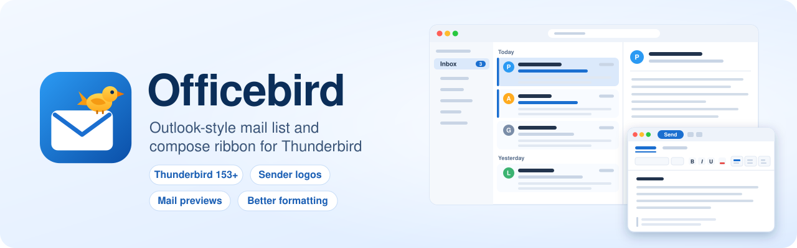

<p align="center">
  <picture>
    <source media="(prefers-color-scheme: dark)" srcset="images/banner-dark.svg">
    
  </picture>
</p>

<p align="center">
  <a href="https://github.com/DirectInsane/officebird/actions/workflows/tests.yml"></a>
  
  
  
</p>

<p align="center">
  <a href="#features">Features</a> ·
  <a href="#install">Install</a> ·
  <a href="#sender-verification">Sender verification</a> ·
  <a href="#privacy">Privacy</a> ·
  <a href="#permissions">Permissions</a> ·
  <a href="#development">Development</a>
</p>

Officebird brings the parts of Outlook that people miss most to Thunderbird: a message list that shows who wrote and what it's about at a glance, and a formatting ribbon for writing mail.

## Features

### Message list

| | |
|---|---|
| **Sender logos** | Each card shows the logo of the sender's company, but only after your mail provider confirmed the sender is genuine. A forged mail, for example one pretending to come from PayPal, gets plain initials and a red **!** instead. Photos from your address book come first; official brand logos (BIMI) are optional. The reading pane shows the same next to the sender's name. |
| **Preview lines** | One to five lines of each mail's text below the subject, also for mails with large attachments. |
| **Unread at a glance** | A blue bar and blue subject mark unread mail; clicking the bar toggles read and unread. Read mail fades back as far as you like. |
| **Card look** | Your theme's cards, or outlined or filled ones. Hovering a card shows a delete button next to the star. |
| **Date groups** | "Today", "Yesterday" and older groups as slim headers, for one folder or all at once. They open expanded in every folder; a group you collapse stays collapsed. |
| **Table view** | Avatars and a preview line in the classic table, and a date column that shows the time for today, the weekday for this week and the date for older mail. |
| **Remote content notice** | Custom colors and a compact size for the "remote content blocked" bar. |
| **Search** | A query field with a filter panel replaces Thunderbird's search bar (it can be brought back in the settings). Type words or use keywords, in English or German: `from:`/`von:`, `to:`/`an:`, `subject:`/`betreff:`, `in:`, `after:`/`nach:`, `before:`/`vor:`, `tag:`/`schlagwort:`, `has:attachment`, `is:unread`, `is:flagged`; `OR` combines, a minus excludes. Results appear in the message list, for **This folder** or **All mailboxes**. |
| **Thunderbird switches** | Unified folders (Inbox, Drafts, Sent, Spam of all accounts) above the accounts, and whether mail is marked read when shown, right in the add-on's settings. |

### Compose window

| | |
|---|---|
| **Ribbon** | Send, Save and Attach always in reach; fonts, sizes, colors, lists, alignment and paragraph styles in two tabs. Hovering an option previews it in your mail. The ribbon collapses to a single row. |
| **Style sets** | Four looks for your own text: Default, Modern, Classic and Compact. Quoted replies, forwards and signatures stay untouched. Pick one as the default for new mail. |
| **Format painter** | Copies formatting from one place to another: click to paint once, double-click to keep painting. Ctrl+Shift+C copies, and on macOS Ctrl+Shift+V pastes. |

Every feature, the ribbon included, can be switched off in the settings.

## Install

Requires Thunderbird 153 or later on Windows, macOS or Linux.

1. Download `officebird-<version>.xpi` from the [latest release](https://github.com/DirectInsane/officebird/releases/latest).
2. In Thunderbird open *Add-ons and Themes → ⚙ → Install Add-on From File…* and choose the file.

To build it yourself instead, run `scripts/build.sh`; the file lands in `dist/officebird.xpi`.

> [!NOTE]
> Thunderbird installs new versions by itself. Restart it after an update: it keeps the add-on's privileged code loaded until then.

> [!TIP]
> The [Clean themes](https://github.com/bakatamas/thunderbird-clean-themes) by [bakatamas](https://github.com/bakatamas) go well with Officebird.

## Sender verification

To trust a sender, Officebird needs to know which server checks your incoming mail. In the settings (*Add-ons and Themes → Officebird → Preferences*), click **Detect from this account's mail** for each account; it finds the name in your recent mail, for Gmail that's `mx.google.com`. You can also enter it by hand. Until then, cards show initials.

> [!IMPORTANT]
> Leave an account empty if its server doesn't add an `Authentication-Results` header. Otherwise a sender could forge one.

## Privacy

| What | Who sees it |
|---|---|
| Sender logos | DuckDuckGo learns which domains mail you, not who you are. Each domain is looked up at most once a month, without cookies or referrer. |
| Brand logos (BIMI, off by default) | Your DNS-over-HTTPS resolver (Cloudflare or Quad9) sees the domain; the brand's logo server sees your IP address. |
| Update check | GitHub sees your IP address when Thunderbird looks for a new version, once a day. |
| Previews and verification | Nobody. Both come from mail already on your computer, and Officebird never runs anything contained in a mail. |

## Permissions

| Permission | Why |
|---|---|
| Read your email messages | Previews, and the `Authentication-Results` header for sender verification |
| Address books | Contact photos as avatars (read only) |
| Storage | Settings and cached logos |
| `icons.duckduckgo.com` | Sender logos |
| All websites (optional, asked when you turn on BIMI) | Brand logos from the sender's own server |

Officebird also uses two experiment APIs, because Thunderbird's regular add-on APIs can't change the message list or the compose window. Experiments run with full access to Thunderbird, which is why Thunderbird shows a warning on install. Officebird uses that access only for the message list, the reading pane and the compose window, and sends nothing beyond what's listed under [Privacy](#privacy). The code is in [`experiments/`](experiments/).

## Limitations

- Previews and verification work for mail stored on your computer: local folders, and IMAP folders kept for offline use (Thunderbird's default).
- Search finds whole words and word beginnings in the mail text through Thunderbird's full-text index. Other parts of words are found by reading the stored mails, which takes longer in large mailboxes. Like previews, this reads mail stored on your computer.
- Plain-text mail has no formatting, so the ribbon's formatting tools have nothing to do there.
- Officebird hooks into Thunderbird's internal code. If a future version changes it, the affected feature turns itself off; *Status* in the settings shows which.

## Development

```bash
npm test                          # unit tests (Node 20+)
scripts/dev/start-thunderbird.sh  # separate Thunderbird on .dev-profile/, Marionette on port 2829
node scripts/dev/marionette.mjs --install "$PWD"                 # load the add-on temporarily
node scripts/dev/marionette.mjs scripts/dev/seed-test-folder.js  # sample mails in a test folder
scripts/dev/test-compose.sh       # compose ribbon integration tests in their own profile
```

Copy `scripts/dev/user.js` to `.dev-profile/user.js` before the first start. The dev scripts currently expect macOS with Thunderbird in `/Applications`.

## License

[MIT](LICENSE) © DirectInsane
